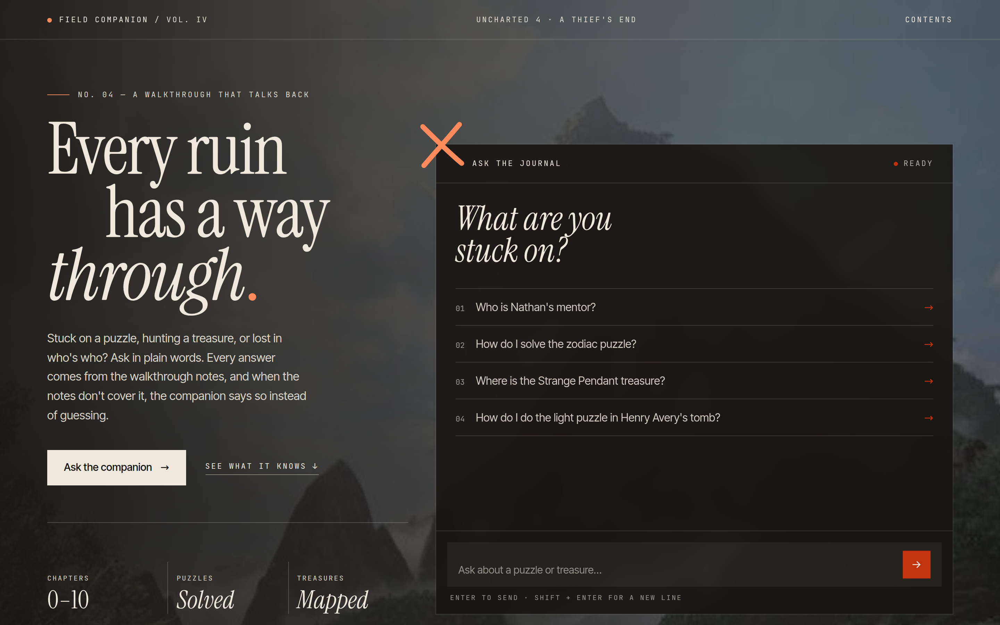

# Field Companion: an Uncharted 4 walkthrough chatbot

Ask it how to solve a puzzle, where a treasure is hidden, or who a character is.
It answers from walkthrough notes using **retrieval-augmented generation (RAG)**,
and when the notes don't cover something, it says so instead of guessing.



## How it works

1. **Ingest** (`ingest.py`): the notes in `data/` are split into paragraph-sized
   chunks, each chunk is turned into an embedding with
   `multi-qa-MiniLM-L6-cos-v1`, and everything is stored in **ChromaDB** along
   with the file it came from.
2. **Retrieve** (`search_test.py`): the question is embedded the same way, the 20
   closest chunks are fetched, and a cross-encoder (`ms-marco-MiniLM-L6-v2`)
   re-ranks them by how well they actually answer the question. The best 4 are kept.
3. **Generate** (`companion.py`, `llm.py`): the question and those chunks go to an
   LLM with instructions to answer only from the notes.
4. **Web app** (`app.py`, `static/`): a Flask JSON API and a hand-written
   HTML / Tailwind / JavaScript chat page.

### Free AI providers with automatic fallback

Free AI APIs are often busy or rate limited, so `llm.py` keeps a list of
providers (Groq, Mistral, NVIDIA, Cerebras, OpenRouter, Cohere, Cloudflare,
Hugging Face, Gemini, and optionally a local Ollama model). They all speak the
OpenAI-compatible API format, so one client talks to all of them. Each question
goes to the first provider that's available; busy, rate-limited or retired
models are skipped automatically, and a rate-limited provider is rested for a
few minutes. Each answer on the page shows which provider wrote it.

## Things I ran into

- **Search found related text, not the answer.** "Who is Nathan's mentor?" didn't
  return Sully's profile in the top 3. Switching to a question-answering embedding
  model wasn't enough on its own; adding a cross-encoder re-ranker moved the right
  chunk to #1.
- **Free APIs change constantly.** During the build, one provider (GitHub Models)
  was shut down and several NVIDIA models were retired (HTTP 410), which is why
  the fallback treats "retired" differently from "busy", and why
  `check_providers.py` exists.
- **Readable text over photos.** The dark overlays on the background images were
  tuned by measuring text contrast against the actual photo pixels.

## Run it locally

```bash
git clone https://github.com/<your-username>/uncharted-companion.git
cd uncharted-companion
python -m venv venv
venv\Scripts\activate          # Windows  (macOS/Linux: source venv/bin/activate)
pip install -r requirements.txt

copy .env.example .env         # macOS/Linux: cp .env.example .env
# then paste at least one API key into .env (sign-up links are inside)

python ingest.py               # build the database from data/
python check_providers.py      # see which of your keys work
python app.py                  # open http://127.0.0.1:5000
```

See [`data/README.md`](data/README.md) for how to write your own notes.

## Tech

Python · sentence-transformers · ChromaDB · Flask · OpenAI-compatible API client ·
HTML · Tailwind CSS · JavaScript

## Notes

- The chapter walkthroughs (adapted from IGN's guide) and the game screenshots used
  as backgrounds are not included in this repository.
- Fan-made learning project. Not affiliated with Naughty Dog or Sony Interactive
  Entertainment. Uncharted is a trademark of Sony Interactive Entertainment.

Made by Yojith N.
